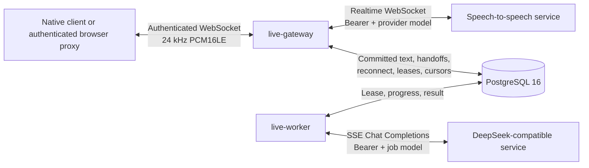

# GPT Live Go framework

GPT Live Go is a production-oriented Go framework for realtime speech plus durable asynchronous reasoning. Clients connect only to `live-gateway`; the gateway owns authentication, bounded audio transport, response fencing, reconnect, and presentation. `live-worker` leases durable background jobs from PostgreSQL and executes bounded DeepSeek reasoning. Neither upstream provider is exposed to clients.

This repository implements an explicit OpenAI Realtime-compatible subset, not every upstream event. Start with [the protocol contract](docs/protocol.md), [security rules](docs/security.md), and [known limitations](docs/limitations.md).



## What is configurable

| Concern | Configuration | Runtime implementation |
|---|---|---|
| Client model name | `gateway.advertised_model` | Exact public alias accepted at the gateway |
| Speech endpoint/model | `gateway.voice.url`, `gateway.voice.model` | Realtime WebSocket adapter in `internal/realtime/s2sws` |
| Async reasoner | `worker.reasoner.base_url`, `worker.reasoner.model` | DeepSeek-compatible SSE Chat Completions adapter |
| Durable async handoffs | `features.handoffs` plus PostgreSQL runtime authority | Gateway handoff coordinator and leased worker |
| Authentication | Local static bearer or production OIDC | Validated before WebSocket upgrade |
| Durability | `store.*`, retention, leases, reconnect | PostgreSQL migrations 1–8 |
| Deployment | Compose or validated Kubernetes overlays | Hardened non-root images and default-deny policies |

The `role` and `provider` strings do not dynamically select an adapter: the gateway currently constructs the S2S WebSocket adapter and the worker constructs the DeepSeek adapter. `provider` participates in the config hash and telemetry; `role` is descriptive and is excluded from the hash.

## Prerequisites

- Go 1.26.
- PostgreSQL 16 for durable/integration paths.
- An OpenAI-Realtime-compatible speech WebSocket, or the separately supplied local simulator image.
- A DeepSeek-compatible streaming Chat Completions endpoint for async reasoning.
- Docker Compose for the shipped local topology.
- For Kubernetes: `kubectl`, `kubeconform`, and, for the full disposable gate, Docker and `kind`.

The repository deliberately does not contain a deployable production speech endpoint, provider credentials, TLS keys, OIDC identities, or production image digests. Its DeepSeek URL/model are public template defaults, not proof that a particular account has access or quota. Operator-reviewed runtime values remain operator-owned.

## Fast start: validate before contacting anything

The default suite does not contact a speech provider, DeepSeek, or a production database:

```sh
go vet ./...
go test ./...
go test -race -count=1 ./...
go build ./...
go mod tidy -diff
make verify-deploy-static
```

Validate and hash the canonical local configuration:

```sh
go run ./cmd/live-gateway check-config --config deploy/config/local.yaml
go run ./cmd/live-worker check-config --config deploy/config/local.yaml

go run ./cmd/live-gateway config-hash --config deploy/config/local.yaml
go run ./cmd/live-worker config-hash --config deploy/config/local.yaml
```

`check-config` is intentionally narrow. It parses strict YAML, applies defaults, validates names and structure, and reads no secret value. It does **not** prove secret availability, database schema, provider authentication, OIDC discovery, OTLP reachability, or runtime composition. The two hash commands must print the same value for the same file.

## Talk to the service in a browser

The repository includes a loopback browser BFF that streams microphone PCM
through `live-gateway`, plays configured speech-provider audio, shows live user
and assistant transcripts, and clears queued playback on a server speech-start
event. For the shortest path, follow the [interactive client quick
start](demo/live-client/README.md) and run:

```sh
make demo-wizard
```

The wizard can start the full durable demo, start only the browser client,
open the **Browser control panel**, check readiness, or stop wizard-owned
services. The explicit control-panel choice opens
[http://127.0.0.1:3000/setup](http://127.0.0.1:3000/setup). Credentials remain
in the terminal or server environment, and the browser can operate only fixed
services. Worker is optional for voice-only use and required for durable
asynchronous tools. Stop dependencies in this order: Client, Worker, Gateway,
PostgreSQL, then Speech. Shutdown does not delete the PostgreSQL volume.
`/setup` is for local development only, never a production admin surface or
release-evidence controller. Use the [complete realtime
browser operator guide](docs/demo/realtime-browser-client.md) for manual
audible-playback/barge-in acceptance, pool-idle checks, and troubleshooting.
Client Stop closes active browser voice WebSockets and rejects new client
connections until explicit Client Start; the persistent `/setup` operator
surface remains available for that restart.

The control-panel speech launcher uses the reviewed local
`/Users/chuanmingliu/speech-to-speech` checkout at
`d0270d79ccb6f5c99f76499bb1dbe8a65608cf51`. Any raw child diagnostic stays in
the operator terminal; the browser/API receives only fixed status codes.

For realtime-only voice, you need a speech service, the local gateway, and the
browser BFF. You do not need a DeepSeek API key, PostgreSQL handoff
configuration, or `live-worker`. Once the guide's gateway is ready, supply the
same local static bearer to the BFF through its operator shell environment:

```sh
read -r -s "LIVE_DEMO_BEARER?Local gateway bearer: "
export LIVE_DEMO_BEARER
printf '\n'
make demo-live-client
```

Open [http://127.0.0.1:3000](http://127.0.0.1:3000). Browser microphone/speaker
permission, audible playback, and physical barge-in remain operator acceptance
checks; automated tests do not claim them. Run the content-free gate with:

```sh
make test-demo-live-client
```

This default gate never starts Docker. The optional local-engine port-publication
check is manual only: `make test-control-panel-port-publish-live`.

For durable asynchronous Web Search, use the same guide's ordered
`development_durable` flow. It prompts for external PostgreSQL, bearer, HMAC,
encryption, speech, and DeepSeek secret references without echoing values;
migrates to schema v8; starts the speech service, gateway, worker, and BFF;
walks the bounded Tools drawer; verifies stable progress while voice and
barge-in continue; proves pools idle; and troubleshoots without printing
content. Its PostgreSQL DSN is container-only: the guide runs migrate and
schema `-check` inside Compose and does not publish the database to the host.
This loopback composition is development acceptance, never production or
release evidence.

## Configure speech-to-speech

Use [configs/gateway.example.yaml](configs/gateway.example.yaml) for a direct local process, or edit the equivalent `gateway` block in your reviewed deployment config:

```yaml
gateway:
  advertised_model: my-public-live-model
  listen_addr: :8080
  voice:
    role: realtime_voice
    provider: speech_to_speech
    url: wss://speech.example.com/v1/realtime
    model: deepseek-v4-flash
    api_key_env: S2S_API_KEY
  audio:
    sample_rate: 24000
    channels: 1
    bytes_per_sample: 2
    frame_bytes: 960
```

The fields have distinct purposes:

- `advertised_model` is the client-facing name. A supplied client `?model=` must match it exactly.
- `voice.model` is the trusted upstream model. The gateway translates the public alias to this value and retains it across reconnect.
- `voice.url` is the bare Realtime WebSocket endpoint. The connector adds `?model=<voice.model>` itself.
- `voice.api_key_env` is an environment-variable **name**, never a credential value. The connector sends the resolved value as `Authorization: Bearer ...`.
- Local mode permits `ws://`; production requires `wss://`. Userinfo, query strings, fragments, and opaque URLs fail validation.
- Provider connection timeout is currently fixed at 10 seconds.

The media contract is fixed: base64-encoded `pcm_s16le`, 24,000 Hz, mono, two bytes per sample, 960-byte/20 ms full frames. The framework does not resample. PCM and partial transcripts are ephemeral and must never be persisted or logged.

### Verify a speech service

The contract suite dials the explicit `S2S_REALTIME_URL` unchanged. Prefer a local/private test endpoint and the canonical `/v1/realtime` path unless you intentionally approved a different service contract:

```sh
S2S_REALTIME_URL=ws://127.0.0.1:8765/v1/realtime \
  go test -count=1 -tags=contract ./test/contract/...
```

Tune `S2S_CONTRACT_CONCURRENCY` only to the actual free provider/simulator capacity. A suite that never handshakes may skip; after any successful handshake, later transport or protocol failure is a failure.

## Configure the asynchronous model service

Use [configs/worker.example.yaml](configs/worker.example.yaml) for a focused worker process, or configure the shared deployment file:

```yaml
worker:
  concurrency: 16
  lease_duration: 30s
  heartbeat_interval: 10s
  poll_interval: 1s
  request_timeout: 30s
  retry_base: 1s
  retry_max: 30s
  max_retries: 3
  max_output_bytes: 1048576
  max_output_tokens: 8192
  max_tool_rounds: 8
  reasoner:
    role: async_gpt_5_5
    provider: deepseek
    base_url: https://api.deepseek.com
    model: deepseek-v4-flash
    api_key_env: DEEPSEEK_API_KEY
```

- Set `base_url` to the API root or parent base path. The adapter appends `/chat/completions`; do not append it twice.
- Production requires HTTPS and rejects URL credentials, queries, and fragments.
- The adapter sends bearer authentication and expects an SSE response.
- The gateway records `reasoner.model` in every durable handoff. The worker uses that immutable job model even if later configuration changes.
- Retryable classes are transport errors, HTTP 408, 429, and 5xx. Backoff is bounded full jitter; a larger `Retry-After` is honored only if another attempt still fits the handoff deadline.
- `heartbeat_interval` must be positive and strictly less than half `lease_duration`.

Manually verify a real account only when you intend to make a live request:

After `DEEPSEEK_API_KEY` is already present through a secure prompt or secret manager:

```sh
DEEPSEEK_BASE_URL=https://api.deepseek.com \
DEEPSEEK_MODEL=deepseek-v4-flash \
  go test -count=1 -tags=liveprovider ./test/liveprovider/...
```

Worker requests, including tool follow-ups, send the provider's official
thinking-disabled request shape and discard reasoning content. When a speech
service uses the same provider account, keep `S2S_API_KEY` and
`DEEPSEEK_API_KEY` as separate process secret references and independently
scoped credentials where the provider supports it.

Do not put the key itself in a tracked command, shell history, YAML file, report, or support log. A missing live-provider configuration skips before a request; once a request starts, failure is not converted to a skip.

## Enable durable async handoffs

Configuring DeepSeek starts a worker adapter, but it does not by itself let a voice session delegate work. End-to-end handoffs require both gates:

1. Static capability: set `features.handoffs: true` in the reviewed **production-mode** gateway configuration.
2. Runtime authority: keep the PostgreSQL feature `handoffs_enabled` enabled. Migration 4 initializes it enabled; an operator may later disable it through the authenticated admin API.

```yaml
features:
  handoffs: true
  side_effecting_tools: false
  runtime_refresh_interval: 1s
```

When enabled, the gateway owns and injects exactly three reserved model-facing tools:

- `start_background_task`
- `steer_background_task`
- `cancel_background_task`

Clients cannot define, replace, or remove those names. With static handoffs disabled, the capability document omits `live.handoff.*`, no reserved tools are injected, and production conversations/transcripts/reconnect durability remain available.

Local mode intentionally rejects `features.handoffs: true` because it lacks the production durable coordinator composition. Use the disposable production-like chaos topology for local end-to-end handoff testing, or deploy the validated production topology. Do not bypass this by weakening validation.

The checked-in production template leaves static handoffs disabled. Enabling them is a reviewed source change: update both [deploy/config/production.yaml](deploy/config/production.yaml) and its synchronized [Kubernetes copy](deploy/k8s/base/production.yaml), then run `make verify-deploy-static`. Editing only one copy fails drift validation.

Runtime enable/disable is an authenticated, audited operation on the loopback admin listener:

```sh
curl --fail-with-body \
  -X PUT http://127.0.0.1:9090/admin/v1/features/handoffs \
  -H "Authorization: Bearer $LIVE_ADMIN_BEARER_TOKEN" \
  -H 'Content-Type: application/json' \
  --data '{"enabled":true,"reason":"approved-rollout"}'
```

Treat the bearer as sensitive and avoid shells or CI modes that echo commands. Verify the public capability document after the static configuration and runtime authority converge.

### Side-effecting tools are separate

`features.side_effecting_tools: true` requires a base64-encoded 32-byte encryption key and an immutable key ID, but it does not register any external tool. The shipped worker registry is empty. Add explicit bounded, idempotent tool implementations and approval policy before enabling this feature.

## Secrets and runtime environment

Fields ending in `_env` must match `[A-Z][A-Z0-9_]*` and contain only an environment-variable name. Keep values in the process environment or an external secret manager.

| Name | Used by | Requirement |
|---|---|---|
| `DATABASE_URL` | gateway, worker, migrate | PostgreSQL URL; the production gateway explicitly rejects `sslmode=disable`, while standalone worker/migrate pass the DSN to PostgreSQL; the deployed production DSN must use verified TLS |
| `S2S_API_KEY` | gateway | Nonempty speech-provider bearer credential |
| `DEEPSEEK_API_KEY` | worker; gateway when using the combined config | Nonempty, at most 16 KiB, no whitespace/control bytes |
| `LIVE_STATIC_BEARER_TOKEN` | local auth/admin | Local only; production forbids static auth |
| `LIVE_ADMIN_BEARER_TOKEN` | drain/preStop/client admin calls | Same as static token locally; narrowly scoped OIDC bearer in production |
| `LIVE_PRIVACY_HMAC_KEY` | shared config/worker | Raw value; worker requires at least 32 bytes |
| `LIVE_RETENTION_HMAC_KEY` | gateway/worker | Base64 of 32–4096 decoded bytes; paired with an immutable key ID |
| `LIVE_RECONNECT_HMAC_KEY` | production gateway | Base64 of 32–4096 decoded bytes; paired with an immutable key ID |
| `LIVE_TOOL_ENCRYPTION_KEY` | worker/shared config | Base64 of exactly 32 decoded bytes; paired with an immutable key ID |
| `LIVE_EXPECTED_CONFIG_HASH` | gateway/worker | Optional binary guard; required by production manifests |
| `LIVE_DEPLOYMENT_REGION` | production gateway/worker | Bounded region identity |
| `LIVE_ALLOWED_REGIONS` | production gateway/worker | Exact comma-separated allowlist containing the region |
| `LIVE_METRIC_INSTANCE` | production gateway | Unique pod/replica identity; not `admission.instance_id` |
| `LIVE_GATEWAY_IMAGE` | production gateway/canary identity | Exact immutable gateway image expected by the deployed runtime |

For disposable development only, generate independent values in memory:

```sh
export LIVE_PRIVACY_HMAC_KEY="$(openssl rand -hex 32)"
export LIVE_RETENTION_HMAC_KEY="$(openssl rand -base64 32)"
export LIVE_RECONNECT_HMAC_KEY="$(openssl rand -base64 32)"
export LIVE_TOOL_ENCRYPTION_KEY="$(openssl rand -base64 32)"
```

Supply `DATABASE_URL`, provider credentials, and bearer tokens through a secure prompt or secret manager. Do not commit a `.env` file; repository deployment scripts explicitly disable implicit `.env` loading.

One subtlety matters when using the combined deployment config: the gateway uses the broad shared secret resolver, so it also requires referenced worker secrets such as `DEEPSEEK_API_KEY`, privacy, retention, and tool keys. The focused worker resolver does not require S2S or reconnect credentials.

## Run focused local processes

The focused examples use different admin ports (`9090` gateway, `9091` worker) and avoid the shared-config port collision.

Prepare a disposable PostgreSQL database and run migrations:

```sh
export DATABASE_URL='postgres://live:<password>@127.0.0.1:5432/live?sslmode=disable'
go run ./cmd/live-migrate -database-url-env DATABASE_URL -direction up
go run ./cmd/live-migrate -database-url-env DATABASE_URL -check
```

Then, in separate terminals after securely supplying the referenced secrets:

```sh
go run ./cmd/live-gateway -config configs/gateway.example.yaml
```

```sh
go run ./cmd/live-worker -config configs/worker.example.yaml
```

The local gateway exercises authenticated speech sessions. The local worker exercises the adapter/lease runtime, but the full gateway-to-worker handoff path remains production-only as described above.

## Run the local Compose topology

The canonical topology is [deploy/docker-compose.yml](deploy/docker-compose.yml). PostgreSQL health gates the one-shot migration; gateway waits for migration completion and S2S startup, while worker independently waits for migration completion. It publishes only loopback ports.

Required inputs include:

- `POSTGRES_PASSWORD` and a matching service-network `DATABASE_URL`.
- `S2S_IMAGE` and an absolute `S2S_CONFIG_PATH` for the separately supplied simulator/service.
- `S2S_API_KEY`.
- `FORMAL_DEEPSEEK_API_KEY`, set to the local DeepSeek credential. Compose deliberately maps this value to `DEEPSEEK_API_KEY` inside gateway and worker.
- Local/static and admin bearer tokens; locally they must be the same value.
- Privacy, retention, reconnect, and tool keys.
- `LIVE_EXPECTED_CONFIG_HASH` from the canonical local config.

Example shape, with values supplied securely before running it. The password
component of `DATABASE_URL` must already be percent-encoded; do not interpolate
a raw password into a URI:

```sh
test -n "${DATABASE_URL:-}"
export FORMAL_DEEPSEEK_API_KEY="$DEEPSEEK_API_KEY"
export LIVE_ADMIN_BEARER_TOKEN="$LIVE_STATIC_BEARER_TOKEN"
export LIVE_EXPECTED_CONFIG_HASH="$(go run ./cmd/live-gateway config-hash --config deploy/config/local.yaml)"

docker compose --env-file /dev/null -f deploy/docker-compose.yml up --build
```

Published defaults:

| URL | Service |
|---|---|
| `http://127.0.0.1:18080` | Gateway public HTTP/WebSocket |
| `http://127.0.0.1:19090` | Gateway diagnostics/admin |
| `http://127.0.0.1:19091` | Worker diagnostics/admin |

The supported bounded deployment smoke is:

```sh
make smoke-deploy
```

It migrates the configured database, waits for readiness, opens one content-free authenticated WebSocket, verifies drain, then runs `down --volumes`. The Compose file has the fixed project name `gpt-live`; do not run the smoke while another `gpt-live` Compose project or volume must be preserved. It is not a provider audio or release-evidence test.

## Production configuration and Kubernetes

[deploy/config/production.yaml](deploy/config/production.yaml) is a non-secret template containing substitution tokens. It is intentionally not directly runnable. Production rendering requires reviewed values for:

- `LIVE_PRODUCTION_HOST`
- `LIVE_PRODUCTION_TLS_SECRET`
- `LIVE_PRODUCTION_TRUSTED_PROXY_CIDR`
- `LIVE_PRODUCTION_EGRESS_PROXY_CIDR`
- `LIVE_PRODUCTION_VOICE_URL`
- `LIVE_PRODUCTION_OIDC_ISSUER`
- `LIVE_DEPLOYMENT_REGION`
- `LIVE_PRODUCTION_GATEWAY_IMAGE`
- `LIVE_PRODUCTION_WORKER_IMAGE`
- `LIVE_PRODUCTION_MIGRATE_IMAGE`

Each image must be a distinct immutable `registry/repository@sha256:<64 lowercase hex>` reference. The gateway runtime currently enforces the reviewed `ghcr.io/chuanmingliu/openai-gpt-live/gateway@sha256:...` identity for `LIVE_GATEWAY_IMAGE`.

Render and validate without applying:

```sh
deploy/scripts/render-kustomize.sh production > /tmp/gpt-live-production.yaml
go run ./deploy/validate --overlay production --readiness deploy /tmp/gpt-live-production.yaml
```

The renderer substitutes the service config inside the Kubernetes ConfigMap, runs the shipped config checker, computes the canonical hash, and injects the same value into pod annotations and `LIVE_EXPECTED_CONFIG_HASH`. Its stdout is the complete Kubernetes manifest, not a standalone YAML service config.

Create these resources out of band before apply:

- `gpt-live/live-secrets` with the overlay-required keys listed in [deploy/k8s/secrets.example.env](deploy/k8s/secrets.example.env). Production does not require the local-only `LIVE_STATIC_BEARER_TOKEN`; the preflight checks required-key presence and does not reject extra keys.
- The named TLS Secret containing `tls.crt` and `tls.key`.
- `gpt-live/live-synthetic-identity` containing exactly one nonempty `data.token`, continuously renewed by the production identity authority.

Then apply through the fail-closed wrapper:

```sh
PROMETHEUS_ADAPTER_CUSTOM_METRICS_READY=true \
  deploy/scripts/deploy-k8s.sh production
```

The script validates and splits the render, applies the owned namespace, checks external Secret inventories without printing values, then applies deny/migration policies, runs migration, applies workloads, and waits for synthetic-canary readiness. External speech and DeepSeek traffic traverses the reviewed egress proxy on TCP/3128; Kubernetes NetworkPolicy cannot authorize provider FQDNs directly.

Read [deploy/README.md](deploy/README.md) before any apply. Back up and restore-test PostgreSQL first, use a disposable database for down/up migration checks, and follow [the rollout thresholds](docs/rollout.md).

## Authentication and client connection

Local mode uses the static bearer named by `auth.static_bearer_env`. Production forbids it and requires:

- HTTPS OIDC issuer and audience.
- Required scopes and tenant/user claim mapping.
- Exact allowed browser origins in the shipped browser-facing topology. A deliberately non-browser production runtime may instead enable `auth.allow_non_browser` with no origins.
- TLS and either verified ingress/trusted proxies or direct TLS.
- Bounded admission and per-IP/session quotas.

The public routes are GET-only:

| Route | Purpose |
|---|---|
| `/v1/realtime` | Authenticated WebSocket |
| `/v1/realtime/capabilities` | Supported protocol/capability document |

A normal WebSocket handshake supplies `Authorization: Bearer ...`, an exact allowed `Origin` when browser policy applies, and optionally `?model=<advertised_model>`. Reconnect uses only the non-secret marker `?reconnect=1`; the first post-upgrade frame carries the credential:

```json
{"type":"session.reconnect","credential":"<opaque credential>"}
```

Never place reconnect credentials in a URL or header. The framework disables production ingress access logs and restores only committed durable state.

The standard browser JavaScript `WebSocket` constructor cannot set an `Authorization` header. This repository does not implement cookie auth, a token-bearing subprotocol, a query-token fallback, or an auth-bootstrap endpoint, and the shipped nginx Ingress only forwards traffic. A browser deployment therefore needs an operator-owned, reviewed WebSocket BFF/authentication proxy that validates the browser session and injects the OIDC bearer when opening the gateway connection; native clients and test clients may set the header directly. Never put an access token in the URL or `Sec-WebSocket-Protocol` unless a future, explicitly designed protocol supports it.

The generic runtime permits a deliberate non-browser policy with `auth.allow_non_browser: true` and no allowed origins. The shipped Kubernetes production validator is browser-facing and requires its exact ingress Origin, so a non-browser-only deployment also requires a reviewed manifest/validator change rather than a YAML-only edit.

Accepted client events and emitted server events are enumerated in [docs/protocol.md](docs/protocol.md). Unknown event types, duplicate JSON keys, malformed UTF-8, unknown security fields, excessive depth, or oversized content fail closed.

## Health, admin, and metrics

Diagnostics expose:

| Endpoint | Method | Purpose |
|---|---|---|
| `/health/live` | GET/HEAD | Process liveness |
| `/health/ready` | GET/HEAD | Dependency, authority, and drain readiness |
| `/metrics` | GET | Prometheus metrics; production also uses metrics-only `:9091` |
| `/admin/v1/capacity` | GET/HEAD | Authenticated capacity snapshot |
| `/admin/v1/sessions` | GET/HEAD | Authenticated session count |
| `/admin/v1/drain` | POST | Begin bounded drain; exact `{}` JSON body |
| `/admin/v1/features/handoffs` | PUT | Audited runtime feature update |
| `/admin/v1/conversations/<id>` | DELETE | Audited durable deletion |

Keep admin loopback-only. The preStop helper reads `LIVE_ADMIN_BEARER_TOKEN` from its environment, sends it only to loopback, and waits for readiness to fall within the pod grace margin.

Production metrics use bounded labels: component, provider, region, instance, and config hash. The PodMonitor preserves unique gateway pod identity. Alerts cover stale output, cross-session leakage, missing synthetic canary, queue overflow, SLO burn, outbox lag, expired leases, readiness, and runtime growth.

## Important defaults and bounds

| Area | Default or enforced bound |
|---|---|
| Gateway listen/storage grace | `:8080`, `30s` |
| Audio | 24 kHz mono PCM16LE; 960-byte full frame |
| Session queues | ingress 25 frames/24,000 bytes; egress 75 frames/72,000 bytes; reactor control 256; writer control 64 |
| WebSocket | max frame 1 MiB; runtime read/write 30s/10s when omitted |
| Reconnect | 2 retries, `100ms`–`1s`, credential TTL `5m` |
| Admission | 1000 global, 100/tenant, 10/user; lease `30s`, heartbeat `10s` |
| Worker | concurrency 1; lease `30s`, heartbeat `10s`, poll `1s`, request `30s`; retries `1s`–`30s` x3 |
| Worker output | 1 MiB, 8192 tokens, 8 tool rounds |
| Retention | conversations `720h`, sweep `1m`, deletion batch 100, approvals `5m` |
| Shutdown | gateway `30s`, worker `120s`, cleanup `5s` |
| Safety | summary 16 KiB; structured result 64 KiB |

The canonical local and production files override some loader defaults, such as local worker concurrency 4 and production concurrency 16. Omitted session block timeouts and WebSocket timeouts hash as zero even though runtime supplies their effective defaults; explicitly writing those values changes the hash.

## Migrations and durable state

Use only a disposable database for down/up validation:

```sh
go run ./cmd/live-migrate -direction up
go run ./cmd/live-migrate -direction down
go run ./cmd/live-migrate -direction up
go run ./cmd/live-migrate -check
```

The embedded latest schema is version 7: core handoffs, coordinator journal, tool-scope constraints, runtime feature authority, deletion provenance, reconnect owners, and generation-fenced coordinator delivery shards.

PostgreSQL stores committed text, conversations, handoffs/events, approvals, leases, idempotency, outbox, cursors, reconnect ownership (including response-epoch high water), retention, and runtime authority. It does not store PCM, partial transcripts, VAD/playback state, sockets, or raw DeepSeek deltas. `LISTEN/NOTIFY` is only an optimization; durable polling/cursors repair missed notifications.

## Test and evidence matrix

| Boundary | Command |
|---|---|
| Unit/race | `go test -race -count=1 ./...` |
| PostgreSQL | `TEST_DATABASE_URL=... go test -race -count=1 -tags=integration ./test/integration/...` |
| S2S contract | `S2S_REALTIME_URL=... go test -count=1 -tags=contract ./test/contract/...` |
| Live DeepSeek | `DEEPSEEK_API_KEY=... DEEPSEEK_BASE_URL=... DEEPSEEK_MODEL=... go test -count=1 -tags=liveprovider ./test/liveprovider/...` |
| Capacity | `make capacity` |
| Barge-in fence | `make barge` |
| Exact soak | `LIVE_SOAK_DURATION=2h make soak` |
| Disposable chaos | Configure all documented `CHAOS_*` inputs, then `make chaos` |
| Static deploy | `make verify-deploy-static` |
| Full disposable deploy | `make verify-deploy` |

Formal load evidence:

```sh
LIVE_EVIDENCE_DIR=/absolute/operator/path make load-smoke
LIVE_EVIDENCE_DIR=/absolute/operator/path make load-evidence
```

`load-smoke` is short and never release evidence. Formal evidence requires the exact 10-minute pinned capacity/SLO gate, 20-sample barge gate, all six application chaos cases, and exact two-hour soak. See [docs/testing.md](docs/testing.md).

The 12-gate release flow is intentionally stricter:

```sh
export RELEASE_CONFIG_HASH='v1:<64-lowercase-hex>'
export LIVE_EVIDENCE_DIR="$PWD/artifacts/task24-formal"
make release-gate
```

Complete unsigned evidence intentionally stops for independent offline Ed25519 privacy approval. Candidate deployment, at least 1,800 seconds of synthetic observation, rollback confirmation, immutable OCI/SBOM/provenance, and human authority are external release requirements. Never reinterpret a skipped suite, fixture render, smoke duration, unpinned host, or unsigned archive as a release pass.

## Troubleshooting

| Symptom | Check first |
|---|---|
| `check-config` passes but startup exits | Secret resolution, DB schema/TLS, OIDC/OTLP, region/instance/image identity, and runtime composition |
| Speech 401/403 | `S2S_API_KEY`, provider account/model access, and no credential in URL |
| Speech handshake 404 | Realtime path is correct and URL has no pre-added model query |
| Client model rejected | Client alias matches `advertised_model`; upstream model belongs only in `voice.model` |
| Output arrives before `response.created` | Known simulator implicit-VAD ordering issue; do not weaken epoch binding |
| DeepSeek 401/403 | Correct key in the worker, account/model access, no whitespace or logging |
| DeepSeek 404 | `base_url` does not already include `/chat/completions` |
| DeepSeek 429 | Quota, bounded `Retry-After`, retry budget, and job deadline |
| Handoffs absent | Production static flag, runtime PostgreSQL authority, capability document, and reserved tool injection |
| Worker loses leases | Heartbeat is below half lease and DB latency fits the authority window |
| `config hash mismatch` | The running ConfigMap/defaults and annotation/environment were generated together |
| `session_limit_reached` | Free simulator slots and `S2S_CONTRACT_CONCURRENCY` |
| Reconnect rejected | `?reconnect=1`, exact first control frame, scope/model/TTL, owner lease, and previous-token overlap |
| Queue overflow | Halt rollout, shed admission, disable handoffs, drain; fix the bottleneck rather than removing bounds |
| Stale output or cross-session leak | Critical: stop rollout, disable handoffs, drain, preserve content-free evidence, and roll back |

Never debug by dumping raw WebSocket frames, PCM, transcript/prompt text, model reasoning, tool arguments/results, bearer tokens, database URLs, or provider response bodies. Use bounded event types, codes, counters, hashes, and non-secret IDs.

## Local Codex skill

The repository packages its implementation and operating knowledge as a reusable Codex skill:

- Versioned source: [skills/gpt-live-go-framework](skills/gpt-live-go-framework)
- Invoke after installation: `$gpt-live-go-framework`

This workspace installs it at `~/.codex/skills/gpt-live-go-framework`. To install the tracked copy in another checkout:

```sh
codex_skill_root="${CODEX_HOME:-$HOME/.codex}/skills"
mkdir -p "$codex_skill_root"
rsync -a skills/gpt-live-go-framework/ "$codex_skill_root/gpt-live-go-framework/"
```

That non-destructive command leaves preexisting extra files in place. Review the destination separately before removing stale/custom files during an upgrade.

The skill routes provider/configuration questions to a strict field and secret reference, architecture changes to component ownership and durability rules, and operations to the supported Compose/Kubernetes/test/release paths. Source and validators remain authoritative when prose and implementation differ.

## Documentation map

- [Protocol](docs/protocol.md): exact client/server event subset, audio, reconnect, and reserved tools.
- [Security](docs/security.md): identity, secrets, privacy, network, side effects, and rotation.
- [Operations](docs/operations.md): migrations, backups, release evidence, and supply-chain checks.
- [Deployment](deploy/README.md): render/apply graph, secrets, hardening, canary, and drain.
- [Testing](docs/testing.md): tagged prerequisites, simulator/live-provider rules, load/chaos evidence.
- [Rollout](docs/rollout.md): progressive thresholds and rollback order.
- [Runbooks](docs/runbooks): database, provider, overload, and rollback incidents.
- [Limitations](docs/limitations.md): supported subset and upstream simulator blocker.
- [Skill configuration reference](skills/gpt-live-go-framework/references/configuration.md), [architecture reference](skills/gpt-live-go-framework/references/architecture.md), and [operations reference](skills/gpt-live-go-framework/references/operations.md).

No production provider, database, cluster, registry, secret file, release signer, or external identity is contacted implicitly.
