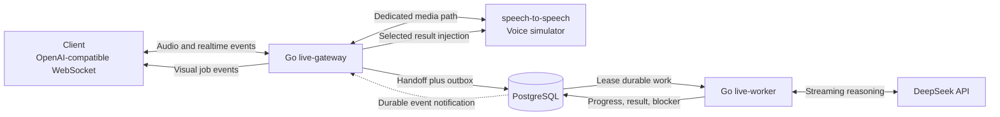

# GPT-Live Go Framework Design

- **Date:** 2026-08-06
- **Status:** Architecture approved in conversation; written specification awaiting final review
- **Module path:** `github.com/chuanmingliu/openai-gpt-live`
- **Minimum Go version:** 1.26

## 1. Purpose

Build a production-shaped, single-region Go framework that reproduces the architectural behavior of GPT-Live without claiming to reproduce OpenAI's native model or global infrastructure.

The framework separates a latency-critical realtime conversation path from durable asynchronous work:

- The existing `speech-to-speech` OpenAI-compatible WebSocket service simulates the live voice coordinator.
- DeepSeek Chat Completions simulates the asynchronously delegated frontier model.
- Go owns transport isolation, session state, explicit handoffs, durable worker execution, result arbitration, reconnect behavior, observability, and deployment.

The first release is WebSocket-first. Browser WebRTC, Pion, TURN, custom UDP relay, multi-region routing, and optimized startup protocols remain later phases.

## 2. Evidence and interpretation boundaries

The design follows the official OpenAI architecture principles described in:

- <https://openai.com/index/continuous-voice-interaction-with-gpt-live/>
- <https://openai.com/index/delivering-low-latency-voice-ai-at-scale/>
- <https://openai.com/index/introducing-gpt-live/>
- <https://developers.openai.com/api/docs/guides/realtime>

The design also uses the independent reverse-engineering analysis at:

- <https://x.com/zicojzc/status/2080665138370388218>

Official sources establish the dedicated media path, continuous interaction, asynchronous delegation, stateful conversation management, and relay/transceiver scaling pattern. The X article informs the explicit handoff and durable-worker control-plane design, but package-specific event names, model identifiers, and inferred server behavior are not treated as public OpenAI contracts.

The local simulator is a cascaded VAD -> STT -> LLM -> TTS pipeline. It can validate realtime protocol behavior, interruption, handoffs, recovery, and isolation, but it cannot reproduce the conversational quality or simultaneous inference of a native full-duplex model.

## 3. Goals

1. Preserve an uninterrupted audio path even when DeepSeek, tools, or persistence are slow.
2. Expose an OpenAI-compatible `/v1/realtime` WebSocket subset to clients.
3. Adapt the existing `speech-to-speech` `/v1/realtime` endpoint as a provider-neutral live voice stream.
4. Turn voice-model delegation calls into durable, explicitly correlated background jobs.
5. Let the voice conversation continue while workers reason, retry, or wait for tools.
6. Allow users to inspect, redirect, and explicitly cancel background work.
7. Speak only selected milestones, blockers, and concise completions; keep detailed results visual and durable.
8. Prevent output from cancelled responses or prior reconnect incarnations from reaching the user.
9. Make concurrency, backpressure, configuration, latency, and failure behavior measurable.
10. Keep provider, transport, storage, and queue implementations replaceable through narrow Go interfaces.

## 4. Non-goals for the first release

- Training or serving a native speech-to-speech model.
- Implementing browser WebRTC, Pion media termination, TURN, or a UDP relay.
- Implementing WARP or Instant Connect.
- Seamlessly migrating an active voice-model KV cache between instances.
- Multi-region routing or global session affinity.
- Persisting raw audio.
- Supporting every OpenAI Realtime API event.
- Providing exactly-once job execution.
- Introducing Kafka, NATS, Redis, Temporal, or a service mesh before measured load requires them.
- Enabling arbitrary external side-effecting worker tools by default.

## 5. System topology



The new Go repository builds two binaries from one module:

- `live-gateway`: realtime transport, session reactor, provider adapter, handoff acceptance, presentation arbitration, and client-facing APIs.
- `live-worker`: PostgreSQL job leasing, DeepSeek streaming, retry and cancellation, registered tools, and durable job events.

Local development uses four containers or processes: gateway, worker, PostgreSQL, and the existing speech-to-speech service.

## 6. Package boundaries

```text
cmd/live-gateway/          Gateway composition root
cmd/live-worker/           Worker composition root
internal/config/           Typed configuration and validation
internal/protocol/         Versioned client and server realtime DTOs
internal/transport/ws/     Downstream WebSocket implementation
internal/realtime/         Provider-neutral live voice interfaces and events
internal/realtime/s2sws/   speech-to-speech WebSocket adapter
internal/session/          Session reactor, state machines, epochs, arbitration
internal/handoff/          Durable handoff types and transitions
internal/worker/           Leasing, execution, retries, and cancellation
internal/reasoner/         Provider-neutral async reasoner interface
internal/reasoner/deepseek DeepSeek streaming adapter
internal/presentation/     Visual versus spoken result policy
internal/store/postgres/   Queries, transactions, outbox, and notifications
internal/safety/           Policy hooks and redaction
internal/telemetry/        Metrics, traces, and structured logging
internal/testkit/          Fake voice, reasoner, clocks, and protocol fixtures
migrations/                PostgreSQL schema migrations
configs/                   Checked-in non-secret example configuration
deploy/                    Docker Compose and Kubernetes manifests
docs/                      Protocol, operations, and architecture documentation
```

Provider JSON is decoded into protocol DTOs and then mapped into provider-neutral domain events. OpenAI SDK types and DeepSeek response types do not become internal state models.

## 7. Realtime protocol surface

The gateway implements the following client events in the first release:

- `session.update`
- `input_audio_buffer.append`
- `input_audio_buffer.commit`
- `conversation.item.create`
- `response.create`
- `response.cancel`

It forwards or synthesizes these server events:

- `session.created`
- `session.updated`
- `error`
- `input_audio_buffer.speech_started`
- `input_audio_buffer.speech_stopped`
- input transcription delta and completed events
- `response.created`
- output audio delta and done events
- output transcript delta or done events
- function-call argument completion
- `response.done`

Framework extensions are namespaced under `live.*`:

- `live.handoff.created`
- `live.handoff.progress`
- `live.handoff.needs_input`
- `live.handoff.completed`
- `live.handoff.failed`
- `live.handoff.cancelled`
- `live.session.degraded`
- `live.session.resumed`

The gateway publishes a protocol capability document. Unknown valid provider fields are retained as bounded `json.RawMessage` only where forwarding compatibility requires it.

### Audio contract

The WebSocket-first release accepts and emits mono signed 16-bit little-endian PCM at 24 kHz, base64 encoded in Realtime JSON events. The gateway splits decoded input into 20 ms frames for accounting and bounded buffering. It does not resample in the first release. The speech-to-speech adapter forwards 24 kHz PCM; the existing service performs its own 16 kHz conversion.

Non-24 kHz input is rejected with a protocol error. A future WebRTC adapter will own Opus decoding and stateful resampling without changing the session or handoff packages.

## 8. Go concurrency model

Each accepted client connection creates a fresh `SessionReactor`. Exactly one reactor goroutine owns mutable session and protocol state.

Each WebSocket has exactly one reader goroutine and one writer goroutine. Ping, pong, close, audio, and control frames all pass through the owning writer; no other goroutine writes to that socket.

```text
client reader -> bounded audio ingress -> voice writer
              -> control inbox -------> session reactor

voice reader  -> bounded media egress -> client writer
              -> control inbox -------> session reactor

worker events -> control inbox -------> session reactor
```

The session reactor never performs WebSocket I/O, database I/O, provider calls, base64 conversion, or tool execution synchronously. Those operations run in supervised tasks and return typed completions to the reactor.

All live-session goroutines are children of `sessionCtx` through `errgroup.WithContext`. A fatal transport error cancels the live session. A `sync.Once` close guard ensures one teardown. Channel ownership is explicit; cancellation uses contexts rather than competing channel closes.

Durable worker jobs never inherit `sessionCtx`. Disconnecting voice does not cancel useful background work.

### Initial queue limits

| Queue | Limit | Policy |
|---|---:|---|
| Client audio ingress | 500 ms decoded PCM | Brief backpressure, then fail the voice session; never silently drop speech |
| Voice audio egress | 1.5 seconds decoded PCM | Drop stale epochs; disconnect a persistently slow current client |
| Session control inbox | 256 events | Terminate on sustained overflow rather than corrupt ordering |
| Each writer control queue | 64 events | Terminal and cancellation events are non-droppable |
| Worker progress per job | Latest event | Coalesce to at most one visible update each second |

All limits are configurable and export depth, bytes, oldest-item age, blocked duration, and overflow metrics.

Ordered control commands carry an `AfterSeq` barrier when they must follow earlier media. Cancellation may bypass the barrier because it invalidates the prior response epoch.

## 9. Identity, ordering, and cancellation

```go
type SessionID string
type ConversationID string
type HandoffID string
type Incarnation uint64
type ResponseEpoch uint64

type TurnKey struct {
    ID       string
    Revision uint32
}
```

- `SessionID` and `ConversationID` identify durable state.
- `Incarnation` increments for every reconnect and fences output from previous sockets.
- `ResponseEpoch` increments for response start, cancellation, barge-in, and provider reconnect.
- `TurnKey` distinguishes provisional transcript revisions from a committed user turn.
- `HandoffID` correlates the spoken request, durable job, worker events, and result presentation.

Every internal envelope carries the applicable IDs and a monotonic sequence number.

Response state is:

```text
idle -> pending -> streaming -> cancel_requested -> terminal -> idle
```

Exactly one terminal event is forwarded or synthesized for each response. On interruption, the reactor cancels the response context, advances the epoch, and rejects all late provider output. Provider cancellation requests work to stop; the epoch is the authoritative stale-output fence.

Barge-in cancels spoken presentation and live response generation. It does not cancel a durable handoff unless the user explicitly requests job cancellation.

Only committed transcript text can create a durable handoff. A tool request that arrives before transcript commitment is held in a bounded pending state and either attached to the committed revision or rejected if that revision is superseded.

## 10. Explicit handoff protocol

The gateway registers three reserved tools with the live voice simulator:

- `start_background_task`
- `steer_background_task`
- `cancel_background_task`

The server, not the model, generates authoritative identifiers.

`HandoffRequestedV1` contains:

- event, handoff, session, conversation, and source-turn identifiers
- finalized user request and normalized objective
- immutable context snapshot reference and hash
- deadline, token budget, and priority
- tool allowlist and approval policy snapshot
- model, prompt, tool-registry, and configuration versions
- presentation hint
- idempotency key

Handoff state is:

```text
pending -> leased -> running -> succeeded
                      |       -> failed
                      |       -> cancelled
                      |       -> expired
                      |
                      -> needs_input -> running
                                     -> cancelled
                                     -> expired
```

`needs_input` may return to `running` after a correlated user answer. Terminal states never transition again.

### Delegation flow

1. The voice model emits `start_background_task`.
2. The reactor associates it with a committed user turn.
3. PostgreSQL atomically stores the handoff and its outbox dispatch record.
4. The gateway returns an immediate `function_call_output` containing `accepted: true` and `handoff_id`.
5. The live model acknowledges the work and continues the conversation.
6. A worker leases the handoff with `FOR UPDATE SKIP LOCKED` and a fenced lease version.
7. The DeepSeek adapter streams reasoning output to the worker, not to the media path.
8. The worker persists state transitions and a structured final result.
9. The gateway receives a PostgreSQL notification and reloads durable events by sequence cursor.
10. The presentation policy selects visual display, deferred speech, immediate clarification, or urgent interruption.

Job delivery is at-least-once. `(handoff_id, attempt)` and every side-effecting tool invocation have idempotency keys. The design never promises exactly-once external effects.

### DeepSeek simulation

The default asynchronous reasoning profile uses:

- protocol: OpenAI-compatible Chat Completions
- base URL: `https://api.deepseek.com`
- model: `deepseek-chat`
- streaming: enabled
- credentials: `DEEPSEEK_API_KEY`

Gateway and worker concurrency budgets are separate so background jobs cannot starve the speech simulator if both ultimately consume DeepSeek capacity.

## 11. Result presentation

Workers never write to a client or voice-provider socket.

`PresentationPolicy` evaluates job state, urgency, whether the user is speaking, whether a response is active, and the last spoken progress event.

- Detailed results always become durable visual events.
- Ordinary progress is visual only and coalesced.
- `needs_input`, important blockers, and concise completion summaries may be spoken.
- Normal results wait until the user is not speaking and the provider has no active response.
- An urgent safety or approval event may explicitly interrupt.

The speech-to-speech simulator supports one active response and per-response instructions. For a selected spoken update, the provider adapter issues an out-of-band `response.create` using a fixed non-overridable instruction template and a bounded structured result encoded as untrusted quoted data. It does not represent worker output as new user speech, splice raw result text into privileged instructions, or overwrite the provider's session instructions.

If the provider rejects out-of-band instructions, the result remains visual and the gateway reports the degraded presentation capability.

## 12. Persistence model

PostgreSQL is the only required durable dependency.

Tables:

- `conversations`: tenant, user, status, retention policy, created and updated timestamps
- `conversation_items`: committed user and assistant text, turn identity, sequence, role, timestamps
- `handoffs`: objective, context reference, permissions, state, lease, attempt, result, version fields
- `handoff_events`: append-only sequenced state and progress events
- `outbox`: durable dispatch and notification records
- `tool_invocations`: approval state, idempotency key, request and result metadata

Persist finalized transcripts, handoffs, state transitions, approvals, tool audit records, version identifiers, usage, and idempotency keys.

Keep raw PCM, partial transcripts, playback buffers, VAD state, sockets, response epochs, and raw DeepSeek token deltas ephemeral.

PostgreSQL transactions plus the outbox make handoff creation and dispatch atomic. `LISTEN/NOTIFY` is a wake-up optimization; the durable event table and cursor are authoritative when notifications are lost.

## 13. Reconnect and recovery

A disconnect invalidates the current response epoch and cancels all live I/O. It does not end the durable conversation or its jobs.

Reconnect creates a new incarnation, opens a new speech provider session, and rehydrates:

- a bounded committed transcript or summary
- active handoff IDs and states
- unresolved clarification or approval requests

Recovery resumes at the next conversational turn. It does not replay a partial microphone utterance or claim seamless mid-audio continuation.

Voice-provider reconnect uses a small jittered retry budget at a turn boundary. DeepSeek failures use `Retry-After`, exponential jitter, capped attempts, tenant bulkheads, and circuit breaking. Expired worker leases allow crash recovery.

If PostgreSQL is unavailable, live voice may continue for a bounded 30-second grace period. New handoffs are rejected. Committed text events may buffer only within configured count and byte limits. If storage does not recover before the grace period or buffer limit, the gateway closes the session rather than pretending durable state was preserved.

## 14. Security and safety

- Authenticate and authorize before WebSocket upgrade through an `Authenticator` interface. Local development uses configured static bearer tokens. Production configuration validates signed JWTs against an OIDC issuer's JWKS, required audience, expiry, and tenant/user claims.
- Enforce TLS, allowed origins, frame-size limits, JSON-depth limits, and global, tenant, and user quotas.
- Keep provider and database credentials server-side and reference secrets through environment-variable names.
- Carry an immutable permission and approval snapshot into every handoff.
- Require explicit approval for destructive, externally visible, costly, or permission-changing actions.
- Treat model, transcript, retrieval, and tool output as untrusted structured data.
- Do not concatenate worker results into privileged system prompts.
- Use a stable privacy-preserving hash as the provider safety identifier.
- Do not log raw audio, credentials, transcript content, or tool arguments by default.
- Redact sensitive values from traces, logs, and errors.
- Apply retention and deletion policy to committed transcripts and job artifacts.

A `SafetyPolicy` hook evaluates worker results before visual or spoken presentation. It can allow, redact, suppress, request clarification, cancel the active response epoch, or terminate the session.

The simulator cannot reproduce GPT-Live's native mid-generation audio safeguards. The first release guarantees policy enforcement for worker-result reinjection and provider-emitted safety/control events, and documents the remaining provider dependency.

## 15. Observability

Use OpenTelemetry traces and Prometheus-compatible metrics. Structured logs use `log/slog` and identifiers rather than content.

Correlation fields:

- session, conversation, incarnation, response epoch, turn, and handoff IDs
- gateway, worker, provider, region, deployment version, and configuration hash

Measure:

- admission, provider connection, and session-ready latency
- per-frame transit and queue residence time
- buffered audio milliseconds, depth, oldest-item age, and overloads
- speech-start to stale-audio suppression
- handoff persistence and acknowledgement latency
- worker queue time, DeepSeek first token, total duration, retries, and tool time
- completion-to-visual and completion-to-speech latency
- outbox lag, lost-notification recovery, expired leases, and duplicate delivery
- reconnect restoration and stale-incarnation rejection
- goroutines, heap, GC pauses, sockets, and active sessions

Dashboards retain per-instance, per-provider, per-region, and per-configuration views so aggregates cannot hide a single unhealthy path.

Endpoints:

- `/health/live`
- `/health/ready`
- `/metrics`
- authenticated administrative capacity and session diagnostics

## 16. Engineering targets

These are project targets, not OpenAI-published guarantees.

| Measurement | Target |
|---|---:|
| Gateway-added audio transit p95 | less than 15 ms |
| Gateway-added audio transit p99 | less than 30 ms |
| Speech-start to queued stale-audio suppression p95 | less than 100 ms |
| Durable handoff acknowledgement p95 | less than 200 ms |
| Worker completion to visual event p95 | less than 250 ms |
| Worker completion to speech scheduling while idle p95 | less than 500 ms |
| Reconnect and text-context restoration p95 | less than 2 seconds |
| Cross-session data or audio leakage | zero |
| Stale-epoch audio delivered after cancellation | zero |
| Unbounded goroutine or heap growth during soak | zero |

The initial controlled-environment end-to-end first-audio target is p50 below 800 ms and p95 below 1.5 seconds. Provider-specific latency is reported separately from gateway-added latency.

## 17. Verification strategy

### Unit and property tests

- Every session, response, turn, handoff, lease, approval, and reconnect transition.
- Exactly one terminal response event.
- Epochs and incarnations never decrease.
- Old incarnations and stale epochs cannot emit output.
- Terminal handoffs cannot re-enter running state.
- Duplicate durable events remain idempotent.
- Presentation arbitration under overlapping user speech, responses, and worker completion.

### Race, fuzz, and static checks

- `go test -race ./...`
- Protocol fuzzing for malformed JSON, excessive nesting, oversized audio, duplicate sequence IDs, and truncated messages.
- `go vet ./...`
- Static analysis and dependency vulnerability scanning in CI.

### Deterministic provider tests

Fake voice and DeepSeek servers control delays, late output, duplicates, stalls, disconnects, rate limits, and corrupt events. Tests use a controllable clock instead of wall-clock sleeps.

### Contract and integration tests

- Exercise the actual local speech-to-speech `/v1/realtime` service.
- Worker completion while the user speaks or another response is active.
- User steering and cancellation.
- Gateway crash after persistence but before acknowledgement.
- Worker crash after a tool side effect.
- Provider disconnect with queued audio.
- Client reconnect with active jobs.
- Duplicate completion and lost PostgreSQL notifications.
- Concurrent sessions with no state contamination.

### Chaos, capacity, and soak tests

Inject database disconnects, DeepSeek throttling, slow clients, stuck providers, worker termination, and notification loss. Capacity is measured as concurrent sessions that meet frame deadlines rather than requests per second.

Fake-provider load tests target at least 250 concurrent gateway sessions before release. Real speech-to-speech integration concurrency is capped by the configured simulator pipeline pool and tested at that declared capacity.

## 18. Rollout

1. Establish deterministic protocol fixtures and fake providers.
2. Complete a single-session client -> gateway -> speech simulator audio loop.
3. Add durable handoff acceptance and a DeepSeek worker.
4. Add result arbitration, steering, cancellation, and reconnect recovery.
5. Add quotas, safety hooks, observability, database recovery, and deployment manifests.
6. Run read-only shadow coordination against representative sessions.
7. Canary by immutable configuration hash: internal traffic, 1%, 5%, 25%, then 100%.
8. Roll back by disabling handoffs or routing clients directly to the existing speech service.
9. Evaluate Pion/WebRTC and relay work only after WebSocket correctness and production measurements justify it.

## 19. Release acceptance gates

The first production-shaped release is acceptable only when:

1. A user can hold a WebSocket voice session through the Go gateway using the existing simulator.
2. The voice coordinator can create a durable DeepSeek handoff, receive immediate acceptance, and continue talking.
3. Worker progress and completion remain correlated to the correct session and handoff.
4. Results can remain visual or be spoken according to the presentation policy.
5. Users can steer and explicitly cancel active handoffs.
6. Barge-in prevents all old-epoch queued audio from reaching the client.
7. Reconnect creates a new incarnation, restores committed text and active jobs, and rejects stale output.
8. Gateway or worker restarts do not lose an accepted durable handoff.
9. Race, fuzz, contract, integration, chaos, and soak gates pass.
10. Metrics demonstrate the stated gateway-added latency and resource-growth targets.
11. No raw audio is persisted or logged by default.
12. Deployment supports admission control, readiness, graceful drain, configuration hashing, and rapid handoff disablement.

## 20. Future evolution

After measured demand establishes the need, the framework can add:

- a Pion WebRTC client transport and transceiver role
- TURN and a fixed-port UDP relay
- regional ingress and sticky routing
- a dedicated event broker replacing PostgreSQL notifications
- a workflow engine for complex approval-heavy jobs
- warm provider-session handoff and background context compaction
- native realtime voice model adapters

The session, transport, voice-provider, reasoner, job-dispatch, store, and presentation interfaces are the intended extraction seams. The first release does not implement speculative distributed abstractions beyond those boundaries.
