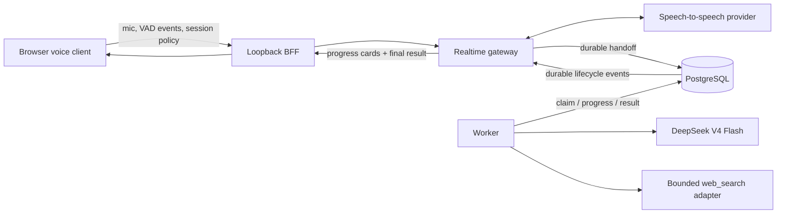

# Realtime Async Web Search Tools Design

## Goal

Extend the realtime browser voice demo with one safe, durable asynchronous tool:
web search. A user can continue a low-latency spoken conversation while a
background search runs, see honest progress in the chat timeline, and receive
the result only after the asynchronous work completes.

This design also standardizes both reasoning paths on the official DeepSeek API
model identifier `deepseek-v4-flash` with thinking disabled. Internal reasoning,
provider reasoning fields, tool transport output, and credentials are never
spoken or presented to the browser.

The realtime path remains the primary product path. Tool execution must never
delay microphone ingestion, voice activity detection, barge-in, assistant audio
playback, or ordinary speech responses.

## User Experience

### Voice remains primary

- The user starts and stops the voice session exactly as before.
- The assistant may acknowledge that a background search was started, but it
  must not narrate hidden reasoning or poll for work synchronously.
- Microphone streaming, server VAD, audio playback, and barge-in continue while
  the search is queued or running.
- The assistant may refer to search findings only after a terminal successful
  result has been delivered.
- Search failure affects its progress card, not the voice session.

### Tools drawer

The existing browser demo gains a compact **Tools** drawer. The first catalog
contains one server-owned preset named **Web Search** with these controls:

- enabled;
- SafeSearch policy;
- region;
- maximum result count; and
- timeout.

The drawer also offers **Test search** and **Save**. Test search uses a fixed,
non-sensitive diagnostic query supplied by the server. It validates reachability
and policy without changing the active conversation.

The browser cannot submit or edit:

- executable commands or arguments;
- package names or package-manager behavior;
- filesystem paths;
- environment-variable names or values;
- credentials;
- arbitrary URLs, hosts, redirect destinations, or headers; or
- tool schemas or server-owned reserved tool names.

The drawer displays the asynchronous model as `deepseek-v4-flash`, with thinking
disabled and configuration managed by the server. It is informational, not a
provider/model picker.

### Timeline progress cards

Each background task has one stable card in chronological chat history. Updates
modify that card by durable handoff ID instead of appending duplicate cards.
Visible phases are deliberately coarse and honest:

1. Queued
2. Searching
3. Reading sources
4. Preparing answer
5. Completed, Failed, or Cancelled

No percentage is inferred from elapsed time. A completed card may show a
bounded answer summary and bounded source title/link pairs. It never shows raw
HTML, provider responses, tool stdout/stderr, internal prompts, chain of
thought, or credentials.

## Existing Framework Boundary

The framework already owns three reserved model-facing handoff controls:

- `start_background_task`;
- `steer_background_task`; and
- `cancel_background_task`.

They create and control durable work; they are not external executor tools.
The gateway continues to register and protect these names. The worker's
immutable registry gains one executor tool, `web_search`, which is permitted
only by the server-owned handoff snapshot and per-session preset.

The existing durable handoff protocol remains the lifecycle transport:

- `live.handoff.created`;
- `live.handoff.progress`;
- `live.handoff.needs_input`;
- `live.handoff.completed`;
- `live.handoff.failed`;
- `live.handoff.cancelled`; and
- the existing approval events when a future side-effecting tool requires them.

This version adds browser handling and strict payload validation; it does not
invent a parallel task protocol.

## Runtime Modes

### `development_durable`

Add an explicit `development_durable` application mode for the loopback demo.
It permits:

- loopback browser/BFF access;
- static local authentication;
- PostgreSQL durability;
- the gateway durable handoff composition;
- the worker; and
- reviewed read-only tool executors.

It must fail closed unless PostgreSQL, handoff configuration, the worker tool
snapshot, and required external secret references are present. It must not be
accepted by production manifest rendering, release evidence, or promotion
workflows. The existing lightweight `local` mode remains memory-only and keeps
rejecting durable handoffs.

### Production

Production retains its existing durable authentication, PostgreSQL, ownership,
recovery, and deployment requirements. The same fixed tool catalog can be
enabled through reviewed configuration, but the browser never receives
production credentials or executor definitions.

## Architecture



The speech connection and browser audio schedulers do not depend on the worker,
PostgreSQL polling latency, DeepSeek latency, or search latency. Durable task
events use existing bounded gateway presentation paths. Tool event processing
must be scheduled independently of audio processing and must not enter audio
worklet queues.

## Session Tool Policy

### Protocol

The browser sends one strict session policy event after the voice session is
created and whenever the user saves a changed preset:

```json
{
  "type": "live.tool_policy.update",
  "event_id": "client-generated-bounded-id",
  "tools": {
    "web_search": {
      "enabled": true,
      "safe_search": "moderate",
      "region": "wt-wt",
      "max_results": 5,
      "timeout_ms": 8000
    }
  }
}
```

The decoder is closed-world: duplicate keys, unknown fields, unknown tools,
invalid enum values, oversized identifiers, unsafe regions, excessive result
counts, and out-of-range timeouts fail closed with a content-free error.
Protocol constants and exact bounds are shared by server validation and browser
tests.

The first catalog freezes these values:

- `event_id`: 1--128 printable ASCII characters using the existing identifier
  grammar;
- `safe_search`: `strict` or `moderate`, default `moderate`;
- `region`: one value from the server-owned reviewed allowlist, with initial
  values `wt-wt`, `us-en`, `uk-en`, `au-en`, `ca-en`, and `cn-zh`, default
  `wt-wt`;
- `max_results`: integer 1--10, default 5; and
- `timeout_ms`: integer 1,000--10,000, default 8,000.

The server may deploy a strict subset of the listed regions or force
`safe_search=strict`; a browser request can never expand that reviewed policy.

The gateway acknowledges the accepted canonical policy with
`live.tool_policy.updated`. The BFF retains only the canonical content-safe
policy in its in-memory session controller so it can resend it after reconnect.
It does not persist the policy in browser storage, cookies, URLs, or logs.

### Durable binding

When `start_background_task` creates a task, the gateway snapshots:

- the immutable worker registry version;
- the enabled tool allowlist;
- the canonical per-session tool policy;
- the configuration hash; and
- existing tenant, user, conversation, and fencing identity.

PostgreSQL persists that snapshot with the job. A worker must execute the exact
snapshot rather than current mutable UI state. Steering may refine a query or
objective through existing bounded handoff semantics, but it cannot add a new
tool, loosen SafeSearch, increase bounds, or change a destination.

## Web Search Executor

### First implementation

The first implementation is an in-repository Go `web_search` adapter behind the
existing `worker.ToolExecutor` interface. It does not execute `npx`, shell
commands, user-defined MCP configuration, or the proposed
`@modelcontextprotocol/server-duckduckgo` package. That package is not published
by the official Model Context Protocol organization, and dynamic package
installation is outside this trust boundary.

The adapter implements a small typed request/result contract and a fixed
DuckDuckGo HTTPS destination. It is read-only and has no side-effect approval
flow.

### Network and resource policy

- Destination scheme and authority are exact and server-owned.
- DNS/IP validation rejects loopback, link-local, private, metadata, multicast,
  and otherwise non-public destinations after every resolution.
- Redirects are disabled or accepted only when the new destination independently
  matches the same exact allowlist.
- Query, SafeSearch, region, locale, result count, and timeout are encoded from
  typed fields only.
- Request and response headers are fixed and credential-free.
- Response bodies, decompressed bodies, result count, title length, snippet
  length, and URL length are bounded before allocation or presentation.
- Result URLs are reparsed and restricted to `https`; browser presentation adds
  safe link attributes.
- Cancellation propagates from handoff cancellation and worker lease loss.
- Logs and metrics contain only stable phase, outcome class, duration bucket,
  count, and configuration labels. They exclude queries, snippets, titles, URLs,
  bodies, and identifiers capable of revealing user content.

The concrete first-version budgets are:

- query text: 1--512 UTF-8 bytes after trimming, with control characters
  rejected;
- request timeout: the effective policy timeout, never more than 10 seconds;
- response body: 512 KiB compressed and 1 MiB decompressed;
- redirect count: zero;
- parsed candidates: at most 20 before filtering and at most the policy's 10
  after filtering;
- title: 256 Unicode scalar values;
- snippet: 1,024 Unicode scalar values; and
- result URL: 2,048 ASCII bytes.

The exact search endpoint is server-owned
`https://html.duckduckgo.com/html/`, sent as a form-encoded POST. The adapter
does not follow response redirects. Parsed destination links are presentation
data only and are never fetched by the worker.

### Future reviewed MCP adapters

The catalog and worker boundary may later host reviewed MCP adapters. Each
adapter must be compiled or immutably packaged by operators, registered under a
server-owned name, assigned exact schemas and network/filesystem privileges,
and included in the configuration hash. The browser may only select such a
preset and bounded policy. It never submits raw `mcpServers` JSON.

## DeepSeek V4 Flash

Both reasoning paths use the official API model identifier
`deepseek-v4-flash`:

- the realtime speech-to-speech service's language-model configuration; and
- the Go worker's asynchronous DeepSeek client.

Both send the official request setting:

```json
{
  "thinking": {
    "type": "disabled"
  }
}
```

The speech service's current generic `chat_template_kwargs.enable_thinking`
translation is not used as a substitute for this DeepSeek API contract. Its
DeepSeek-compatible request builder must emit the official field. The Go worker
also emits it explicitly.

Any returned `reasoning_content` is ignored and never logged, persisted,
spoken, placed in tool progress, or sent to the browser. Only the final bounded
assistant content can drive a spoken or visual result.

Tracked examples, development profiles, validation fixtures, operator docs, and
tests that still name retired `deepseek-chat` or `deepseek-reasoner` are updated
to `deepseek-v4-flash`. A model value supplied through untrusted browser input
is rejected; model selection remains server-owned and config-hash-bound.

## Worker Execution Flow

1. The gateway durably creates a handoff with the exact tool-policy snapshot.
2. The worker claims the handoff using the existing ownership and fencing
   rules.
3. The worker asks DeepSeek for a tool decision with thinking disabled.
4. A `web_search` call is decoded against the immutable typed schema.
5. The worker emits the stable `searching` phase and calls the bounded adapter.
6. It emits `reading_sources` only after a valid bounded result set exists.
7. It asks DeepSeek for the final answer with thinking disabled and emits
   `preparing_answer`.
8. The final answer and bounded sources are committed before a terminal
   lifecycle event is presented.
9. The gateway delivers the terminal event idempotently; the browser updates
   the existing card.

Retries use existing durable lease/fencing behavior. A task is idempotent by
handoff ID, tool call ID, registry version, and canonical policy. A stale worker
cannot publish progress or results after losing authority. Restart recovery
continues from committed state without repeating a committed terminal event.

## Browser State and Rendering

The browser protocol state owns a bounded map keyed by handoff ID. Each entry
stores only:

- handoff ID and monotonic lifecycle revision;
- stable phase/status enum;
- bounded timestamps;
- bounded user-safe summary;
- bounded source title/link pairs; and
- whether an action such as cancel is currently available.

Unknown state transitions, regressing revisions, duplicate terminal events,
and events for a fenced session are ignored or fail the affected card safely.
The maximum active and finalized card counts, total source count, and aggregate
text budget are fixed. Eviction removes only terminal cards, oldest first.

Progress rendering is coalesced with the existing transcript publication path
so bursts cannot force unbounded DOM layout. Audio capture/playback state has
higher scheduling priority and no dependency on card rendering.

The browser retains at most 64 active cards and 64 terminal cards. One card has
an 8 KiB UTF-8 summary budget, at most 10 sources, and the title/link bounds
defined above. Aggregate card text is capped at 256 KiB. Exceeding an active
card or aggregate budget fails the affected session content-free; terminal-card
pressure evicts the oldest terminal card. No audio bytes, search bodies, or raw
provider events enter this map.

Accessibility requirements:

- the Tools drawer is keyboard operable and reports expanded state;
- switches and fields have explicit labels and validation messages;
- status cards expose a concise polite live-region update only when the stable
  phase changes;
- no spinner is the sole status signal; and
- source links identify that they open an external site.

## Failure and Recovery

- PostgreSQL unavailable: new durable tasks fail closed; the voice session
  continues and the card reports a content-free unavailable state.
- Worker unavailable: the card remains Queued; voice continues.
- Search timeout or policy rejection: only that task fails.
- DeepSeek timeout or malformed response: only that task fails and private
  response material is discarded.
- Gateway reconnect: the BFF resends canonical policy and durable handoff
  recovery restores cards by ID/revision.
- Browser reload: the development BFF may restore currently authorized durable
  task presentation through existing reconnect/recovery semantics; browser
  storage is not used.
- Barge-in: current assistant audio is fenced exactly as today. Search work
  continues unless the user or model explicitly cancels the handoff.
- Cancel: cancellation reaches the worker and HTTP client, and later stale
  progress/result events are fenced.

## Security and Privacy Invariants

- No credential is accepted from or returned to the browser.
- No raw query or result content is logged, placed in metric labels, or included
  in error messages.
- No private reasoning is spoken, persisted, or displayed.
- No dynamic npm, MCP, shell, executable, environment, or arbitrary network
  configuration is accepted.
- Search is read-only and cannot access local files or private networks.
- Tool policy is canonical, durable, config-hash-bound, and cannot be loosened
  by steering.
- Existing tenant/user/conversation scoping, reconnect ownership, journal
  fencing, and content bounds remain mandatory.
- Browser source links are escaped, HTTPS-only, and use safe external-link
  attributes.
- The demo keeps transcripts, audio, and policy out of browser persistent
  storage.

## Configuration and Operator Boundary

Tracked configuration contains only model identifiers, secret-reference names,
fixed tool catalog metadata, and bounded policy defaults. Operators provide
actual values through existing external secret mechanisms:

- DeepSeek API credential for the speech service;
- DeepSeek API credential for the worker;
- PostgreSQL URL/credentials for durable development or production;
- existing gateway authentication and reconnect secrets; and
- speech-provider credentials required by the configured speech pipeline.

The operator does not install a DuckDuckGo npm package or enter a search API
credential for the first adapter. The browser never receives any of these
values.

## Testing

### Unit and component tests

- strict tool-policy JSON decoding, enums, duplicates, unknowns, and bounds;
- canonical policy hashing and durable snapshot immutability;
- browser drawer state, save/ack/reconnect behavior, and accessibility;
- handoff card ordering, revision deduplication, bounds, terminal states, and
  eviction;
- exact stable progress-phase transitions;
- DeepSeek request bodies use `deepseek-v4-flash` and official thinking-disabled
  syntax in both speech and worker paths;
- `reasoning_content` is discarded;
- search URL construction, DNS/IP policy, redirects, response/body limits,
  result sanitization, cancellation, and content-free errors;
- worker registry immutability, policy enforcement, idempotency, lease loss,
  restart recovery, and stale-event fencing; and
- audio/VAD/playback/barge-in regression suites remain unchanged and green.

### Integration tests

- `development_durable` starts with disposable PostgreSQL, gateway, worker, and
  deterministic fake speech/DeepSeek/search services;
- a real browser protocol session starts a search while voice traffic continues;
- progress appears in exact order and terminal output updates one card;
- disconnect/reconnect restores the policy and cards without duplicate work;
- worker restart resumes the task;
- cancellation stops search and fences a late result;
- search/DeepSeek failures do not close the realtime speech session; and
- a disabled Web Search preset cannot be invoked.

### Opt-in live tests

Real DuckDuckGo and DeepSeek calls are separate, credential/egress-authorized
smoke tests. They use non-sensitive fixed prompts, bounded output, and do not
form part of deterministic unit tests. Physical microphone, speaker playback,
and acoustic barge-in remain operator-observed acceptance steps.

## Documentation and Delivery

Implementation updates the realtime browser operator guide with:

- PostgreSQL and worker startup for `development_durable`;
- exact external secret-reference setup without printing values;
- speech and worker model verification for `deepseek-v4-flash`;
- Tools drawer use and the difference between controls and executors;
- progress-card and cancellation behavior;
- failure recovery and privacy checks; and
- the future reviewed-MCP extension process.

The previously requested local reusable framework skill is updated only after
the implementation and operator guide are verified, so it describes shipped
behavior rather than this proposal.

## Out of Scope

- arbitrary user-supplied MCP server JSON;
- `npx` or runtime package installation;
- filesystem, email, calendar, code-execution, browser-control, or other
  side-effecting tools;
- browser-entered provider credentials or model selection;
- exposing chain of thought or provider reasoning content;
- narrating progress percentages or tool transport logs;
- coupling realtime audio scheduling to background-task execution; and
- claiming production readiness from the loopback `development_durable` mode.

## External References

- DeepSeek API model list: <https://api-docs.deepseek.com/api/list-models>
- DeepSeek V4 announcement: <https://api-docs.deepseek.com/news/news260424/>
- DeepSeek thinking-mode request contract:
  <https://api-docs.deepseek.com/guides/thinking_mode>
- DeepSeek chat-completion API:
  <https://api-docs.deepseek.com/api/create-chat-completion>
- Official Model Context Protocol npm organization:
  <https://www.npmjs.com/org/modelcontextprotocol>
